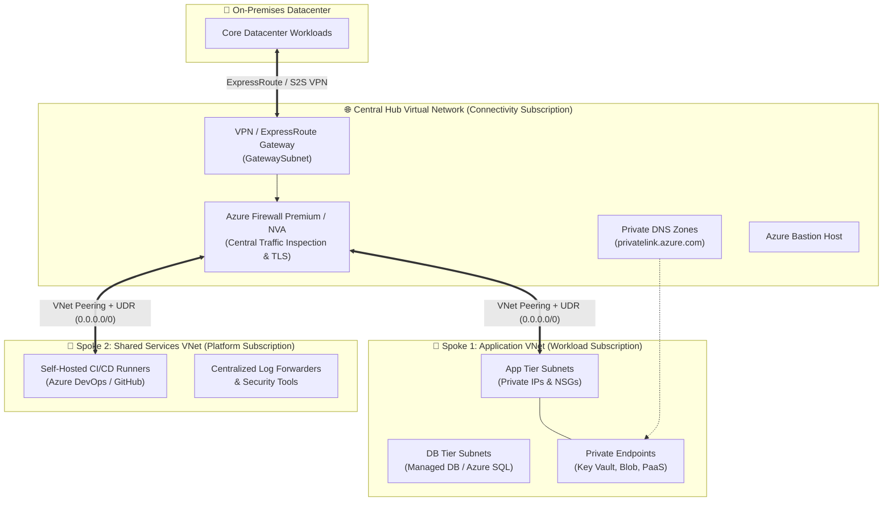
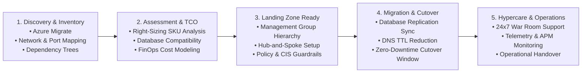
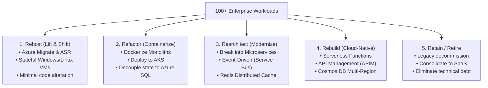

<div align="center">

<!-- HERO BANNER -->
<p align="center">
  
</p>

<!-- DYNAMIC TYPING ANIMATION -->
<a href="https://git.io/typing-svg">
  
</a>

<p align="center">
  <b>10+ Years Total IT Experience &bull; 8+ Years DevOps & DevSecOps Engineering &bull; Cloud & Infrastructure Architect</b>
</p>

<!-- EXECUTIVE MILESTONE BADGES -->
<p align="center">
  
  
  
  
</p>

<!-- SOCIAL & QUICK ACTION BADGES -->
<p align="center">
  <a href="https://linkedin.com/in/vishwjeetmehta" target="_blank">
    
  </a>
  <a href="mailto:vishwjeetmehta@gmail.com">
    
  </a>
  <a href="./SENIOR_DEVOPS_ARCHITECT_GUIDE.md">
    
  </a>
  <a href="https://github.com/vishwjeetmehta-bot?tab=repositories">
    
  </a>
</p>

<!-- QUICK NAVIGATION BAR -->
<p align="center">
  <a href="#-executive-summary"><b>Summary</b></a> &bull;
  <a href="#-executive-impact--quantified-metrics"><b>Impact Metrics</b></a> &bull;
  <a href="#-professional-experience--consulting-journey"><b>Experience</b></a> &bull;
  <a href="#%EF%B8%8F-technical-ecosystem--core-competencies"><b>Skills &amp; Tech Stack</b></a> &bull;
  <a href="#%EF%B8%8F-enterprise-architecture--technical-blueprints"><b>Blueprints</b></a> &bull;
  <a href="#-devsecops-security-pipeline-matrix"><b>DevSecOps</b></a> &bull;
  <a href="#-finops-optimization-engine--tactics"><b>FinOps</b></a> &bull;
  <a href="#-architectural-decision-records-adr-showcase"><b>ADRs</b></a> &bull;
  <a href="#%EF%B8%8F-hardened-kubernetes-aks-zero-trust-checklist"><b>AKS Hardening</b></a> &bull;
  <a href="#-cloud-migration-rationalization-the-5-rs-framework"><b>5 Rs Migration</b></a> &bull;
  <a href="#-business-continuity--disaster-recovery-bcdr-tiering-matrix"><b>BCDR Matrix</b></a> &bull;
  <a href="#-enterprise-observability--kql-query-toolkit-azure-monitor"><b>KQL Toolkit</b></a> &bull;
  <a href="#-featured-reference-architectures--repositories"><b>Repositories</b></a> &bull;
  <a href="#-github-analytics--contributions"><b>Analytics</b></a> &bull;
  <a href="#-lets-connect--collaborate"><b>Contact</b></a>
</p>

---

</div>

## 📌 Executive Summary

I am a **Senior DevOps & DevSecOps Consultant** at **Shiksha Samadhan Pvt. Ltd.** with **10+ years of comprehensive IT industry experience**, including **8+ years dedicated to DevOps and DevSecOps engineering, cloud architecture, and infrastructure automation**. 

Throughout my career, I have served as the technical bridge between executive business vision and mission-critical engineering execution. My consulting practice centers on transforming legacy, disjointed infrastructure into secure, automated, highly available, and cost-efficient cloud ecosystems:

* 💼 **Consulting & Leadership @ Shiksha Samadhan Pvt. Ltd.:** Driving enterprise cloud adoption strategies, designing multi-region resilient landing zones, and institutionalizing shift-left DevSecOps security across development squads.
* 🌐 **Enterprise Cloud Scale:** Proven track record in orchestrating multi-subscription **Microsoft Cloud Adoption Framework (CAF)** Enterprise Landing Zones and executing zero-downtime cutovers for **100+ multi-tier workloads**.
* 🛡️ **DevSecOps & Zero-Trust Security:** Embedding automated security gates (SAST with SonarQube, SCA with Trivy/Snyk, secret scanning with GitLeaks, and IaC posture with Checkov) directly into CI/CD release trains with policy-as-code guardrails.
* 💰 **FinOps & Cloud Economics:** Eliminating cloud waste, implementing automated lifecycle scheduling, rightsizing compute/storage resources, and optimizing commitments for **25%+ sustainable cloud spend reduction**.
* 🤝 **Stakeholder Governance & Mentorship:** Translating business imperatives into architectural blueprints, leading vendor RFPs/SOW evaluations, establishing RACI delivery frameworks, and mentoring cross-functional engineering teams.

---

## ⚡ Executive Impact & Quantified Metrics

<div align="center">

| Metric | Category | Business Impact & Operational Scale |
| :---: | :---: | :--- |
| **10+ Years** | **Industry Foundation** | **Total IT Experience** spanning systems engineering, enterprise infrastructure, cloud transformation, and consulting |
| **8+ Years** | **Specialization** | **Specialized DevOps & DevSecOps Engineering** architecting resilient CI/CD pipelines, IaC, and Kubernetes platforms |
| **Current** | **Consulting Role** | **Senior DevOps & DevSecOps Consultant** leading infrastructure modernization at **Shiksha Samadhan Pvt. Ltd.** |
| **100+** | **Cloud Migration** | **Enterprise Workloads Migrated** from On-Premises to Cloud with zero data loss, zero unplanned downtime, and structured hypercare |
| **99.99%** | **Availability (SRE)** | **High Availability SLA** achieved via multi-zone VMSS, active geo-redundancy, and automated Azure Site Recovery (ASR) |
| **28%** | **FinOps Economics** | **Average Cloud Spend Reduction** driven by proactive FinOps governance, compute rightsizing, and RI commitments |
| **Zero Trust** | **Security Posture** | **Multi-Layer Defense** enforced across Entra ID (PIM/RBAC), Hub Firewall NVA inspection, and Private Endpoints |
| **100% IaC** | **Automation** | **Modular Terraform & CI/CD Drift Detection** eliminating manual configuration drift across enterprise environments |

</div>

---

## 💼 Professional Experience & Consulting Journey

```
┌────────────────────────────────────────────────────────────────────────────────────────────────────────┐
│                                   CAREER EVOLUTION TIMELINE (10+ YEARS)                                │
├────────────────────────────────┬───────────────────────────────────────┬───────────────────────────────┤
│    SYSTEMS & INFRASTRUCTURE    │       DEVOPS & CLOUD AUTOMATION       │  SR. DEVSECOPS & ARCHITECTURE │
│    Linux/Windows Admin & Netw  │       CI/CD, IaC, Docker & Kubernetes │  Consulting, CAF, FinOps, SRE │
│           (Year 1 - 2)         │             (Year 3 - 6)              │      (Year 7 - Present)       │
└────────────────────────────────┴───────────────────────────────────────┴───────────────────────────────┘
```

### 🏢 Senior DevOps & DevSecOps Consultant &bull; *Shiksha Samadhan Pvt. Ltd.*
* **Enterprise Cloud Architecture:** Design and deploy multi-subscription landing zones following Microsoft Cloud Adoption Framework (CAF) with strict Hub-and-Spoke network isolation and zero public endpoint exposure.
* **DevSecOps Shift-Left Transformation:** Architect end-to-end CI/CD delivery pipelines in Azure DevOps and GitHub Actions, embedding static analysis (SAST), software composition analysis (SCA), container vulnerability scanning (Trivy), and secret detection (GitLeaks).
* **Policy as Code & Compliance:** Enforce enterprise governance using Azure Policy, Checkov, and CIS Benchmarks at the Management Group scope, ensuring automated guardrails and audit readiness.
* **FinOps Governance:** Spearhead cloud cost optimization programs, implementing compute rightsizing, storage tier lifecycle policies, and automated scheduling for non-production environments to slash operational waste by 25%+.
* **Kubernetes & Container Hardening:** Manage hardened Azure Kubernetes Service (AKS) clusters with Azure CNI, pod identity, Network Policies, ingress controllers, and automated cert-manager TLS rotations.
* **Engineering Leadership & Client Advisory:** Serve as the senior technical advisor to leadership and clients; conduct architectural review boards, vendor SOW evaluations, and mentor DevOps engineers across agile release trains.

### 🏛️ The 10-Year Engineering Foundation (Summary of Milestones)
* **Enterprise Systems & Networking Foundation:** Mastered bare-metal operating systems, virtualization (VMware/Hyper-V), network topology design (CIDR, subnetting, routing protocols, firewalls), and systems security.
* **DevOps Engineering & Automation Wave:** Automated manual provisioning using Terraform, Ansible, and Shell/PowerShell scripts; introduced trunk-based development, automated testing, and containerization with Docker and Kubernetes.
* **Senior Architectural Leadership:** Led cross-functional teams in planning, designing, and executing enterprise digital transformations, cloud migrations, disaster recovery runbooks, and FinOps budgeting.

---

## 🛠️ Technical Ecosystem & Core Competencies

<div align="center">

### ☁️ Cloud Platforms & Hyperscalers


### 🏗️ Infrastructure as Code & Orchestration


-326CE5?style=for-the-badge&logo=kubernetes&logoColor=white)


### 🛡️ CI/CD, DevSecOps & Shift-Left Security


### 🔐 Security, Identity & Zero-Trust Architecture


### 📈 Observability, SRE & Telemetry


### 💻 Scripting, Automation & Languages


</div>

---

## 🏛️ Enterprise Architecture & Technical Blueprints

Below are reference designs and architectural pillars synthesized from real-world enterprise deployments.

<details open>
<summary><b>📐 1. Enterprise Hub-and-Spoke Networking Architecture (Zero-Trust Topology)</b></summary>
<br>

A centralized, secure Hub-and-Spoke architecture designed to enforce traffic inspection, eliminate overlapping CIDRs, and isolate blast radiuses:



* **Zero Direct Egress:** All outgoing internet traffic forced through Azure Firewall via UDR (`0.0.0.0/0 -> Firewall Private IP`) with full TLS inspection and FQDN filtering.
* **Private PaaS:** Storage accounts, Key Vaults, and Databases accessed strictly via **Private Endpoints**—never exposed to public internet endpoints.
* **IPAM & Governance:** Rigid subnet segmentation preventing noisy neighbors and IP overlap across on-prem and multi-region landing zones.

</details>

<details>
<summary><b>🚀 2. End-to-End Migration Strategy (100+ Enterprise Workloads)</b></summary>
<br>

A battle-tested migration lifecycle based on the **Microsoft Cloud Adoption Framework (CAF)**:



#### The 10 Enterprise Scalability & Quality Pillars
```
+--------------------------------------------------------------------------------------------------+
|                                  10 Architectural Quality Pillars                                |
|                                                                                                  |
|  1. Scalable      2. Robust        3. Secure        4. Reliable       5. Portable                |
|  6. Governed      7. High Avail    8. Cost-Optim    9. Backed Up      10. Compliant & Monitored  |
+--------------------------------------------------------------------------------------------------+
```

* **Pre-Migration:** Dependency mapping, bandwidth stress testing, target landing zone validation, and rollback rehearsal.
* **Cutover Window:** Continuous delta synchronization, traffic rerouting via traffic managers, sanity smoke suites.
* **Post-Migration Hypercare:** 2 to 4 weeks dedicated war room support, log analysis, baseline metric tuning.

</details>

<details>
<summary><b>🛡️ 3. Production DevSecOps & Terraform IaC Pipeline Workflow</b></summary>
<br>

Fully automated, multi-gate CI/CD delivery pipeline for infrastructure code:

```
[ Terraform Git Repo ] 
         │
         ▼
[ Linting & Quality Gate ] ────────► terraform fmt -check & tflint
         │
         ▼
[ Static Security Analysis ] ──────► tfsec, Checkov (CIS Benchmarks), GitLeaks (Secrets)
         │
         ▼
[ Cloud Cost Estimation ] ─────────► Infracost (Pull Request Diff & Budget Thresholds)
         │
         ▼
[ Automated Plan & Drift ] ────────► terraform plan -detailed-exitcode & Artifact Generation
         │
         ▼
[ Production Gate Approval ] ──────► Multi-Peer Approval (Min 2 Senior Reviews + CODEOWNERS)
         │
         ▼
[ Automated Deployment ] ──────────► terraform apply (State locked via Azure Blob Storage Lease)
```

* **Remote State Governance:** Azure Blob Storage with customer-managed keys (CMK), private endpoints, and automated blob lease locking to prevent race conditions.
* **Nightly Drift Detection:** Scheduled automated pipelines running `terraform plan` against live infrastructure to proactively detect and flag unmanaged console changes.
* **Trunk-Based Branching:** Protected `main` branch with mandatory PR status checks, unit tests, and automatic rollback triggers on deployment failure.

</details>

<details>
<summary><b>🏢 4. Enterprise Governance, Management Groups & Defense-in-Depth</b></summary>
<br>

Enterprise hierarchy enforcing separation of duties and zero-trust controls:

```
                            [ Microsoft Entra ID Tenant ]
                                          │
                              [ Tenant Root Group ]
                                          │
         ┌────────────────────────────────┼────────────────────────────────┐
         │                                │                                │
[ Platform Management Group ]   [ Landing Zones (Workloads) ]    [ Decommissioned / Sandbox ]
   ├── Identity (AD/DNS)           ├── Corp (Internal-only VNets)   ├── Sandbox Subscriptions
   ├── Management (Central Logs)   ├── Online (Public DMZ VNets)    └── Decommissioned Subscriptions
   └── Connectivity (Hub/Firewall) ├── Dev Subscriptions
                                   ├── UAT Subscriptions
                                   └── Prod Subscriptions
```

| Security Layer | Enforcement & Controls |
| :--- | :--- |
| **Identity & Access** | Microsoft Entra ID, Conditional Access, Multi-Factor Authentication (MFA), Just-in-Time access via **Privileged Identity Management (PIM)**, Managed Identities. |
| **Network Security** | Hub-and-Spoke topology, NSG/ASG micro-segmentation, Azure Firewall Premium with IDPS, Private Endpoints, DDoS Network Protection. |
| **Governance & Policy** | Azure Policy initiatives (**CIS Azure Foundations Benchmark, MCSB**) enforced at Management Group scope with time-bound, documented exemptions. |
| **Workload & Data Protection** | Defender for Cloud & Servers, automated vulnerability scanning, Customer-Managed Key (CMK) disk encryption, TLS 1.3 in transit. |

</details>

<details>
<summary><b>💰 5. FinOps, Disaster Recovery & High-Availability Resilience</b></summary>
<br>

* **FinOps Optimization Lifecycle:**
  * **Waste Elimination:** Automated serverless tasks detecting and removing unattached managed disks, orphaned snapshots, idle IP allocations, and abandoned test resources.
  * **Rightsizing Engine:** Monthly CPU/Memory 95th-percentile utilization analysis resizing over-provisioned VMs and container nodes.
  * **Commitment Planning:** Balancing Azure Savings Plans and Reserved Instances (1-yr / 3-yr) for stable production workloads, yielding 25–40% cost reductions.
  * **Automated Non-Prod Scheduling:** Automated start/stop workflows shutting down Dev/UAT environments during non-business hours.

* **High Availability & Business Continuity (BCDR):**
  * **RTO (Recovery Time Objective):** < 30 minutes for mission-critical core services.
  * **RPO (Recovery Point Objective):** < 15 minutes of transactional data loss via continuous geo-replication.
  * **Storage Redundancy Strategy:** LRS for temporary scratch, ZRS for local high-availability within Availability Zones, and GRS/GZRS for critical database backups replicated to paired regions.

</details>

<details>
<summary><b>👔 6. Executive Leadership, Vendor Management & RACI Delivery Governance</b></summary>
<br>

Senior technical leadership requires navigating cross-functional stakeholder dynamics, evaluating vendors, and maintaining strict delivery quality:

* **Procurement & Proposal Lifecycle:** Translating enterprise requirements into **RFIs/RFPs**, scoring vendor proposals via objective **Technical Evaluation Matrices**, and drafting precise **Statements of Work (SOW)** with clear deliverable milestones.
* **RACI Framework Enforcement:**
  * **R (Responsible):** Engineering squad executing hands-on implementation.
  * **A (Accountable):** Technical Lead / Architect with single-point ownership of architectural integrity.
  * **C (Consulted):** Domain experts across InfoSec, Networking, and Database teams.
  * **I (Informed):** Product Owners, Executive Leadership, and Business Stakeholders.
* **Escalation & SLA Governance:** Defined contractual escalation paths, mean-time-to-respond (MTTR) thresholds, and formal knowledge transfer (KT) runbook handoffs prior to project sign-off.

</details>

---

## 🛡️ DevSecOps Security Pipeline Matrix

Enterprise security is not an afterthought; it is shifted left into every stage of the software and infrastructure lifecycle:

| Stage | Security Domain | Tooling Implemented | Gate Policy / Enforcement | Compliance Target |
| :--- | :--- | :--- | :--- | :--- |
| **Commit** | Secret Detection | `GitLeaks` `pre-commit` | Reject commit if API keys or tokens are detected | Zero Hardcoded Secrets |
| **Pull Request** | IaC Posture (SAST) | `Checkov` `tfsec` | Block PR if HIGH/CRITICAL CIS violations exist | CIS Azure Benchmark |
| **PR Validation** | Cost Estimation | `Infracost` | Flag diff if monthly cost delta exceeds $500 threshold | FinOps Budget Alert |
| **Build** | Code Quality & SAST | `SonarQube` | Quality Gate: Zero new vulnerabilities or security hotspots | OWASP Top 10 |
| **Package** | Container Scanning | `Trivy` `Docker Scan` | Block image push to ACR if fixable CRITICAL CVEs exist | NIST SP 800-190 |
| **Deploy** | Policy Guardrails | `Azure Policy` `Gatekeeper` | Deny deployment with public IPs or unencrypted storage | MCSB Benchmark |
| **Runtime** | Threat Detection | `Defender for Cloud` `Falco` | Real-time behavioral anomaly alerts to SOC via Webhooks | Zero Trust Runtime |

---

## 💰 FinOps Optimization Engine & Tactics

How I drive a sustainable **25% to 30%+ reduction in recurring cloud infrastructure expenditure**:

```
┌────────────────────────────────────────────────────────────────────────────────────────┐
│                              FINOPS 4-PHASE OPTIMIZATION LIFECYCLE                     │
├────────────────────┬────────────────────┬─────────────────────┬────────────────────────┤
│ 1. VISIBILITY      │ 2. OPTIMIZATION    │ 3. COMMITMENTS      │ 4. AUTOMATION          │
│ Cost Allocation    │ Rightsizing CPU/RAM│ Reserved Instances  │ Auto Stop/Start Dev/UAT│
│ Tagging Policies   │ Orphan Disk Purge  │ Azure Savings Plans │ Storage Lifecycle Rules│
│ Ingestion Tuning   │ Snapshot Pruning   │ 1-Yr vs 3-Yr RI ROI │ Anomaly Detection Alerts│
└────────────────────┴────────────────────┴─────────────────────┴────────────────────────┘
```

1. **Tag-Driven Cost Attribution:** Enforce mandatory cost-center, environment, and owner tags at the subscription root via Azure Policy (`Deny` action on untagged resources).
2. **Compute Rightsizing:** Analyze 30-day 95th-percentile CPU and Memory telemetry in Azure Monitor; downsize over-provisioned B-series, D-series, and E-series instances.
3. **Storage Lifecycle Automation:** Automatically transition unaccessed blob storage data from Hot to Cool tier after 30 days, and Archive tier after 90 days.
4. **Log Analytics Ingestion Filtering:** Use Data Collection Rules (DCR) on Azure Monitor Agent (AMA) to filter noisy diagnostic and performance event logs at source, cutting log workspace ingestion costs by 35%+.

---

## 📋 Architectural Decision Records (ADR) Showcase

In senior architecture consulting, every technical choice requires disciplined trade-off analysis and clear business justification. Below are representative Architectural Decision Records (ADRs) I author and govern:

| ADR ID | Decision Subject | Choice Made | Alternative Evaluated | Business & Technical Rationale |
| :---: | :--- | :--- | :--- | :--- |
| **ADR-001** | **Identity & Elevation** | **Entra ID + PIM JIT** | Static Service Principals | Eliminates standing privilege vulnerabilities; enforces multi-stage approval and time-bound access. |
| **ADR-002** | **Central Egress Inspection** | **Azure Firewall Premium NVA** | NSG-Only Distributed Routing | Centralizes URL/FQDN filtering, TLS decryption, and IDPS intrusion detection for 100+ spoke VNets. |
| **ADR-003** | **Kubernetes Network Plane** | **Azure CNI Overlay** | Kubenet | Avoids IP exhaustion in on-prem CIDRs while supporting scalable pod IP allocation and native Network Policies. |
| **ADR-004** | **IaC CI/CD Cost Controls** | **Infracost PR Diffs** | Post-Deployment Invoices | Shifts FinOps left into GitHub PRs; prevents unintended $10k+ SKU provisioning before code is applied. |
| **ADR-005** | **Branching & Delivery** | **Trunk-Based (Short-Lived)** | GitFlow | Drastically reduces merge debt, accelerates DORA deployment frequency, and simplifies rollback branches. |

---

## ☸️ Hardened Kubernetes (AKS) Zero-Trust Checklist

How I architect and govern production-grade container platforms across client environments:

```
┌─────────────────────────────────────────────────────────────────────────────────────────────────┐
│                                 AKS PRODUCTION HARDENING PILLARS                                │
├─────────────────────────┬──────────────────────────┬───────────────────────┬────────────────────┤
│ 1. IDENTITY & ACCESS    │ 2. NETWORK ISOLATION     │ 3. POD & IMAGE SEC    │ 4. RUNTIME AUDIT   │
│ Azure AD Workload Id    │ Azure CNI + Network Pol  │ Trivy CVE Scanning    │ Falco Behavioral   │
│ Disabled Local Accounts │ Private AKS API Server   │ Pod Security PSA:Restr│ Azure Monitor Log  │
│ Azure RBAC for K8s      │ Private Endpoints Only   │ Distroless Base Images│ Defender Container │
└─────────────────────────┴──────────────────────────┴───────────────────────┴────────────────────┘
```

* **Zero Public API Exposure:** AKS Control Plane deployed as a **Private Cluster**, accessible only via Azure Bastion, VPN Gateway, or self-hosted CI/CD runners in the management spoke.
* **Workload Identity:** Completely eliminated Kubernetes Secrets for cloud access; pods use Azure AD Workload Identity with federated credentials to access Key Vaults and Storage.
* **Admission Controller Enforcements:** Enforcing Pod Security Standards (`restricted` profile) rejecting privileged containers, root execution, and host path mounts.
* **Network Micro-segmentation:** Default-deny egress and ingress network policies; pods can only communicate with explicitly whitelisted services and private endpoints.

---

## 🔄 Cloud Migration Rationalization (The 5 Rs Framework)

For large-scale migrations (100+ workloads), each workload must be categorized according to the 5 Rs framework:



---

## 🚨 Business Continuity & Disaster Recovery (BCDR) Tiering Matrix

Clear Recovery Time Objectives (RTO) and Recovery Point Objectives (RPO) enforced across workload tiers:

| Tier | Workload Classification | Target RTO | Target RPO | Architecture Pattern | Replication & Backup Strategy |
| :---: | :--- | :---: | :---: | :--- | :--- |
| **Tier 1** | **Mission-Critical Core** | **< 30 min** | **< 5 min** | Multi-Region Active/Passive with Traffic Manager | Azure SQL Active Geo-Replication, ASR Continuous Sync |
| **Tier 2** | **Business-Essential** | **< 4 hours** | **< 1 hour** | Multi-Zone VMSS within Primary Region | Zone-Redundant Storage (ZRS) + 6-hour Geo-Backups |
| **Tier 3** | **Internal & Batch Systems** | **< 24 hours** | **< 24 hours** | Single Region with IaC Re-hydration | Locally Redundant Storage (LRS) + Daily Backup Vault |

---

## 📈 Enterprise DevOps & DevSecOps Maturity Framework

How I benchmark and guide client organizations across 5 progressive stages of cloud maturity:

| Maturity Dimension | Level 1: Initial | Level 2: Standardized | Level 3: Automated (DevSecOps) | Level 4: Governed (FinOps & SRE) | Level 5: Elite Autonomous |
| :--- | :--- | :--- | :--- | :--- | :--- |
| **Infrastructure** | Manual portal clicks | Basic shell scripts | Modular Terraform IaC | Automated Drift Detection & CAF | Self-healing platform engineering |
| **CI/CD Delivery** | Manual server deploy | Jenkins snowflake VMs | Azure DevOps YAML templates | Multi-stage approvals & Canary | GitOps with ArgoCD & automated rollback |
| **Security Posture**| End-of-cycle audits | Periodic manual scans | SAST/SCA & GitLeaks in PRs | Azure Policy & Checkov CIS gates | Zero-Trust runtime defense & Falco |
| **Cost Management**| Reactive monthly bills| Ad-hoc VM shutdown | Infracost PR budget alerts | Rightsizing & 1-3yr RI Modeling | Autonomous container bin-packing |
| **Observability** | OS Event logs | Basic ping checks | Centralized Log Analytics AMA | KQL anomaly alerts & MTTR SLAs | OpenTelemetry distributed tracing |

---

## 🔍 Enterprise Observability & KQL Query Toolkit (Azure Monitor)

In enterprise cloud environments, proactive SRE observability relies on Log Analytics Workspace telemetry and precise Kusto Query Language (KQL) rules:

<details>
<summary><b>🔎 1. FinOps: Identify Top 5 Cost-Driving Log Analytics Tables</b></summary>
<br>

```kql
Usage
| where TimeGenerated > ago(30d)
| where DataType !in ("Heartbeat", "Usage")
| summarize TotalGBytes = sum(Quantity) / 1000 by DataType
| top 5 by TotalGBytes desc
| project DataType, TotalGBytes, EstimatedCostUSD = TotalGBytes * 2.30
```
</details>

<details>
<summary><b>🔎 2. Security: Detect Brute-Force SSH / RDP Inbound Failures on Hub Firewall</b></summary>
<br>

```kql
AzureDiagnostics
| where Category == "AzureFirewallNetworkRule"
| where msg_s has "DENY" and (msg_s has "3389" or msg_s has "22")
| parse msg_s with Protocol " request from " SourceIP ":" SourcePort " to " TargetIP ":" TargetPort
| summarize FailedAttempts = count() by SourceIP, TargetIP, TargetPort, bin(TimeGenerated, 15m)
| where FailedAttempts > 10
| order by FailedAttempts desc
```
</details>

<details>
<summary><b>🔎 3. SRE: Alert on Kubernetes Pod CrashLoopBackOff & OOMKilled Containers</b></summary>
<br>

```kql
KubePodInventory
| where TimeGenerated > ago(1h)
| where PodStatus in ("Failed", "CrashLoopBackOff") or ContainerStatusReason == "OOMKilled"
| summarize IncidentCount = count() by Namespace, Name, ContainerName, ContainerStatusReason, ClusterName
| order by IncidentCount desc
```
</details>

---

## 💼 IT Career Progression & Leadership Matrix

```
+------------+       +---------------+       +---------+       +----------------------+       +----------------+
|   Sales    | ----> |   Pre-Sales   | ----> |   TAM   | ----> | Enterprise Architect | ----> | Technical Lead |
| Commercial |       | Techno-       |       | Tech    |       | Infra + Application  |       | Infra / App    |
| Focus      |       | Functional    |       | Account |       | Strategy & Design    |       | Execution      |
|            |       | Proposals     |       | Manager |       |                      |       |                |
+------------+       +---------------+       +---------+       +----------------------+       +----------------+
```

* **Pre-Sales & Proposals:** Driving RFPs/RFIs, authoring architectural estimations, delivering technical demos, and shaping commercial proposals.
* **Technical Architecture:** Designing end-to-end cloud landing zones, security guardrails, disaster recovery strategies, and application modernization roadmaps.
* **Delivery & Mentorship:** Enforcing code/IaC reviews, upskilling engineering teams through KT sessions, and serving on senior interview evaluation panels.

---

## 📂 Featured Reference Architectures & Repositories

Explore my production-ready IaC modules and DevSecOps frameworks:

| Repository / Module | Description | Primary Technologies | Architecture Type |
| :--- | :--- | :--- | :--- |
| 🌐 [**azure-enterprise-landing-zone**](https://github.com/vishwjeetmehta-bot) | Production Terraform module implementing Microsoft CAF Hub-and-Spoke architecture, Azure Firewall, and Private DNS. | `Terraform` `Azure` `HCL` `Networking` | Enterprise Infrastructure |
| 🛡️ [**devsecops-pipeline-templates**](https://github.com/vishwjeetmehta-bot) | Reusable Azure DevOps & GitHub Actions YAML templates integrating Checkov, Trivy, GitLeaks, and Infracost. | `Azure Pipelines` `GitHub Actions` `Checkov` | Security & Compliance |
| ☸️ [**hardened-aks-cluster-baseline**](https://github.com/vishwjeetmehta-bot) | Production-ready AKS baseline with Azure CNI, Pod Identity, Ingress-Nginx, cert-manager, and network policies. | `Kubernetes` `AKS` `Helm` `Bash` | Container Orchestration |
| 💰 [**azure-finops-waste-cleaner**](https://github.com/vishwjeetmehta-bot) | Automated serverless functions and PowerShell scripts to identify orphaned disks, idle IPs, and unattached snapshots. | `PowerShell` `Python` `Azure Functions` | FinOps & Automation |
| 🔄 [**terraform-drift-detection-engine**](https://github.com/vishwjeetmehta-bot) | Scheduled pipeline automator that compares live Azure state against Git IaC baselines and triggers Teams alerts on drift. | `Terraform` `Bash` `Azure DevOps` `Webhooks` | SRE & Operations |

> 📖 **Looking for comprehensive technical interview prep & architecture deep-dives?**  
> Check out the complete in-depth handbook: [**`SENIOR_DEVOPS_ARCHITECT_GUIDE.md`**](./SENIOR_DEVOPS_ARCHITECT_GUIDE.md) covering architectural case studies, migration checklists, FinOps tactics, and vendor governance in detail.

---

## 📊 GitHub Analytics & Contributions

<div align="center">


<br>


</div>

---

## 🤝 Let's Connect & Collaborate

Whether you are looking to discuss **large-scale cloud migrations**, **enterprise landing zones**, **DevSecOps automation**, or **senior architectural consulting opportunities**, I would love to connect!

<div align="center">

<a href="https://linkedin.com/in/vishwjeetmehta" target="_blank">
  
</a>
&nbsp;
<a href="mailto:vishwjeetmehta@gmail.com">
  
</a>
&nbsp;
<a href="https://github.com/vishwjeetmehta-bot">
  
</a>

<br><br>

<sub>Designed with ❤️ and built for enterprise scale by <b>Vishwjeet Kumar Mehta</b> &bull; Senior DevOps & DevSecOps Consultant @ Shiksha Samadhan Pvt. Ltd. &bull; Last updated 2026</sub>

</div>
