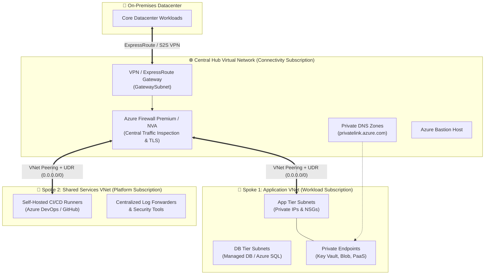
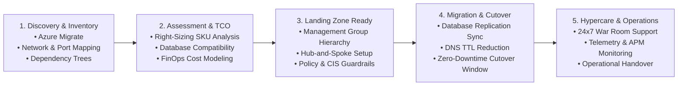

<div align="center">

<!-- HERO BANNER -->


<!-- TYPING ANIMATION -->
<a href="https://git.io/typing-svg">
  
</a>

<p align="center">
  <b>10+ Years Total IT Experience &bull; 8+ Years DevOps & DevSecOps Engineering &bull; Cloud & Infrastructure Architect</b>
</p>

<!-- HIGHLIGHT BADGES -->
<p align="center">
  
  
  
  
</p>

<!-- SOCIAL & ACTION BADGES -->
<p align="center">
  <a href="https://linkedin.com/in/vishwjeetmehta" target="_blank">
    
  </a>
  <a href="mailto:vishwjeetmehta@gmail.com">
    
  </a>
  <a href="./SENIOR_DEVOPS_ARCHITECT_GUIDE.md">
    
  </a>
  <a href="https://github.com/vishwjeetmehta-bot?tab=repositories">
    
  </a>
</p>

---

</div>

## 📌 Executive Summary

I am a **Senior DevOps & DevSecOps Consultant** at **Shiksha Samadhan Pvt. Ltd.** with **10+ years of comprehensive IT industry experience**, including **8+ years dedicated to DevOps and DevSecOps engineering, cloud architecture, and infrastructure automation**. 

My career combines deep hands-on technical execution with high-level consulting and architectural advisory:
* 💼 **Consulting & Leadership @ Shiksha Samadhan Pvt. Ltd.:** Driving enterprise cloud adoption strategies, designing multi-region resilient landing zones, and institutionalizing shift-left DevSecOps security across development squads.
* 🌐 **Enterprise Cloud Scale:** Proven track record in orchestrating multi-subscription **Microsoft Cloud Adoption Framework (CAF)** Enterprise Landing Zones and executing zero-downtime cutovers for **100+ multi-tier workloads**.
* 🛡️ **DevSecOps & Zero-Trust Security:** Embedding automated security gates (SAST with SonarQube, SCA with Trivy/Snyk, secret scanning with GitLeaks, and IaC posture with Checkov) directly into CI/CD release trains with policy-as-code guardrails.
* 💰 **FinOps & Cloud Economics:** Eliminating cloud waste, implementing automated lifecycle scheduling, rightsizing compute/storage resources, and optimizing commitments for **25%+ sustainable cloud spend reduction**.
* 🤝 **Stakeholder Governance & Mentorship:** Translating business imperatives into architectural blueprints, leading vendor RFPs/SOW evaluations, establishing RACI delivery frameworks, and mentoring cross-functional engineering teams.

---

## ⚡ Executive Impact & Key Metrics

<div align="center">

| Metric | Business Impact & Operational Scale |
| :---: | :--- |
| **10+ Years** | **Total IT Experience** spanning systems engineering, enterprise infrastructure, cloud transformation, and consulting |
| **8+ Years** | **Specialized DevOps & DevSecOps Engineering** architecting resilient CI/CD pipelines, IaC, and Kubernetes platforms |
| **Current Role** | **Senior DevOps & DevSecOps Consultant** leading infrastructure modernization at **Shiksha Samadhan Pvt. Ltd.** |
| **100+** | **Enterprise Workloads Migrated** from On-Premises to Cloud with zero data loss and structured hypercare |
| **99.99%** | **High Availability SLA** achieved via multi-zone VMSS, active geo-redundancy, and Azure Site Recovery |
| **28%** | **Average Cloud Spend Reduction** driven by proactive FinOps governance, rightsizing, and RI commitments |
| **Zero Trust** | **Multi-Layer Defense** enforced across Entra ID (PIM/RBAC), Hub Firewall NVA, and Private Endpoints |
| **100% IaC** | **Modular Terraform & CI/CD Drift Detection** eliminating manual configuration drift across environments |

</div>

---

## 💼 Professional Experience & Consulting Highlights

### 🏢 Senior DevOps & DevSecOps Consultant &bull; *Shiksha Samadhan Pvt. Ltd.*
* **Enterprise Cloud Architecture:** Design and deploy multi-subscription landing zones following Microsoft Cloud Adoption Framework (CAF) with strict Hub-and-Spoke network isolation and zero public endpoint exposure.
* **DevSecOps Shift-Left Transformation:** Architect end-to-end CI/CD delivery pipelines in Azure DevOps and GitHub Actions, embedding static analysis (SAST), software composition analysis (SCA), container vulnerability scanning (Trivy), and secret detection (GitLeaks).
* **Policy as Code & Compliance:** Enforce enterprise governance using Azure Policy, Checkov, and CIS Benchmarks at the Management Group scope, ensuring automated guardrails and audit readiness.
* **FinOps Governance:** Spearhead cloud cost optimization programs, implementing compute rightsizing, storage tier lifecycle policies, and automated scheduling for non-production environments to slash operational waste by 25%+.
* **Kubernetes & Container Hardening:** Manage hardened Azure Kubernetes Service (AKS) clusters with Azure CNI, pod identity, Network Policies, ingress controllers, and automated cert-manager TLS rotations.
* **Engineering Leadership & Client Advisory:** Serve as the senior technical advisor to leadership and clients; conduct architectural review boards, vendor SOW evaluations, and mentor DevOps engineers across agile release trains.

---

## 🛠️ Technical Ecosystem & Core Competencies

<div align="center">

### Cloud Platforms & Architecture


### Infrastructure as Code & Orchestration


-326CE5?style=for-the-badge&logo=kubernetes&logoColor=white)


### CI/CD, DevSecOps & Shift-Left Security


### Security, Identity & Zero-Trust


### Observability, SRE & Automation


</div>

---

## 🏛️ Enterprise Architecture & Technical Blueprints

Below are reference designs and architectural pillars synthesized from real-world enterprise deployments.

<details open>
<summary><b>📐 1. Enterprise Hub-and-Spoke Networking Architecture (Zero-Trust Topology)</b></summary>
<br>

A centralized, secure Hub-and-Spoke architecture designed to enforce traffic inspection, eliminate overlapping CIDRs, and isolate blast radiuses:



* **Zero Direct Egress:** All outgoing internet traffic forced through Azure Firewall via UDR (`0.0.0.0/0 -> Firewall Private IP`) with full TLS inspection and FQDN filtering.
* **Private PaaS:** Storage accounts, Key Vaults, and Databases accessed strictly via **Private Endpoints**—never exposed to public internet endpoints.
* **IPAM & Governance:** Rigid subnet segmentation preventing noisy neighbors and IP overlap across on-prem and multi-region landing zones.

</details>

<details>
<summary><b>🚀 2. End-to-End Migration Strategy (100+ Enterprise Workloads)</b></summary>
<br>

A battle-tested migration lifecycle based on the **Microsoft Cloud Adoption Framework (CAF)**:



#### The 10 Enterprise Scalability & Quality Pillars
```
+--------------------------------------------------------------------------------------------------+
|                                  10 Architectural Quality Pillars                                |
|                                                                                                  |
|  1. Scalable      2. Robust        3. Secure        4. Reliable       5. Portable                |
|  6. Governed      7. High Avail    8. Cost-Optim    9. Backed Up      10. Compliant & Monitored  |
+--------------------------------------------------------------------------------------------------+
```

* **Pre-Migration:** Dependency mapping, bandwidth stress testing, target landing zone validation, and rollback rehearsal.
* **Cutover Window:** Continuous delta synchronization, traffic rerouting via traffic managers, sanity smoke suites.
* **Post-Migration Hypercare:** 2 to 4 weeks dedicated war room support, log analysis, baseline metric tuning.

</details>

<details>
<summary><b>🛡️ 3. Production DevSecOps & Terraform IaC Pipeline Workflow</b></summary>
<br>

Fully automated, multi-gate CI/CD delivery pipeline for infrastructure code:

```
[ Terraform Git Repo ] 
         │
         ▼
[ Linting & Quality Gate ] ────────► terraform fmt -check & tflint
         │
         ▼
[ Static Security Analysis ] ──────► tfsec, Checkov (CIS Benchmarks), GitLeaks (Secrets)
         │
         ▼
[ Cloud Cost Estimation ] ─────────► Infracost (Pull Request Diff & Budget Thresholds)
         │
         ▼
[ Automated Plan & Drift ] ────────► terraform plan -detailed-exitcode & Artifact Generation
         │
         ▼
[ Production Gate Approval ] ──────► Multi-Peer Approval (Min 2 Senior Reviews + CODEOWNERS)
         │
         ▼
[ Automated Deployment ] ──────────► terraform apply (State locked via Azure Blob Storage Lease)
```

* **Remote State Governance:** Azure Blob Storage with customer-managed keys (CMK), private endpoints, and automated blob lease locking to prevent race conditions.
* **Nightly Drift Detection:** Scheduled automated pipelines running `terraform plan` against live infrastructure to proactively detect and flag unmanaged console changes.
* **Trunk-Based Branching:** Protected `main` branch with mandatory PR status checks, unit tests, and automatic rollback triggers on deployment failure.

</details>

<details>
<summary><b>🏢 4. Enterprise Governance, Management Groups & Defense-in-Depth</b></summary>
<br>

Enterprise hierarchy enforcing separation of duties and zero-trust controls:

```
                            [ Microsoft Entra ID Tenant ]
                                          │
                              [ Tenant Root Group ]
                                          │
         ┌────────────────────────────────┼────────────────────────────────┐
         │                                │                                │
[ Platform Management Group ]   [ Landing Zones (Workloads) ]    [ Decommissioned / Sandbox ]
   ├── Identity (AD/DNS)           ├── Corp (Internal-only VNets)   ├── Sandbox Subscriptions
   ├── Management (Central Logs)   ├── Online (Public DMZ VNets)    └── Decommissioned Subscriptions
   └── Connectivity (Hub/Firewall) ├── Dev Subscriptions
                                   ├── UAT Subscriptions
                                   └── Prod Subscriptions
```

| Security Layer | Enforcement & Controls |
| :--- | :--- |
| **Identity & Access** | Microsoft Entra ID, Conditional Access, Multi-Factor Authentication (MFA), Just-in-Time access via **Privileged Identity Management (PIM)**, Managed Identities. |
| **Network Security** | Hub-and-Spoke topology, NSG/ASG micro-segmentation, Azure Firewall Premium with IDPS, Private Endpoints, DDoS Network Protection. |
| **Governance & Policy** | Azure Policy initiatives (**CIS Azure Foundations Benchmark, MCSB**) enforced at Management Group scope with time-bound, documented exemptions. |
| **Workload & Data Protection** | Defender for Cloud & Servers, automated vulnerability scanning, Customer-Managed Key (CMK) disk encryption, TLS 1.3 in transit. |

</details>

<details>
<summary><b>💰 5. FinOps, Disaster Recovery & High-Availability Resilience</b></summary>
<br>

* **FinOps Optimization Lifecycle:**
  * **Waste Elimination:** Automated serverless tasks detecting and removing unattached managed disks, orphaned snapshots, idle IP allocations, and abandoned test resources.
  * **Rightsizing Engine:** Monthly CPU/Memory 95th-percentile utilization analysis resizing over-provisioned VMs and container nodes.
  * **Commitment Planning:** Balancing Azure Savings Plans and Reserved Instances (1-yr / 3-yr) for stable production workloads, yielding 25–40% cost reductions.
  * **Automated Non-Prod Scheduling:** Automated start/stop workflows shutting down Dev/UAT environments during non-business hours.

* **High Availability & Business Continuity (BCDR):**
  * **RTO (Recovery Time Objective):** < 30 minutes for mission-critical core services.
  * **RPO (Recovery Point Objective):** < 15 minutes of transactional data loss via continuous geo-replication.
  * **Storage Redundancy Strategy:** LRS for temporary scratch, ZRS for local high-availability within Availability Zones, and GRS/GZRS for critical database backups replicated to paired regions.

</details>

<details>
<summary><b>👔 6. Executive Leadership, Vendor Management & RACI Delivery Governance</b></summary>
<br>

Senior technical leadership requires navigating cross-functional stakeholder dynamics, evaluating vendors, and maintaining strict delivery quality:

* **Procurement & Proposal Lifecycle:** Translating enterprise requirements into **RFIs/RFPs**, scoring vendor proposals via objective **Technical Evaluation Matrices**, and drafting precise **Statements of Work (SOW)** with clear deliverable milestones.
* **RACI Framework Enforcement:**
  * **R (Responsible):** Engineering squad executing hands-on implementation.
  * **A (Accountable):** Technical Lead / Architect with single-point ownership of architectural integrity.
  * **C (Consulted):** Domain experts across InfoSec, Networking, and Database teams.
  * **I (Informed):** Product Owners, Executive Leadership, and Business Stakeholders.
* **Escalation & SLA Governance:** Defined contractual escalation paths, mean-time-to-respond (MTTR) thresholds, and formal knowledge transfer (KT) runbook handoffs prior to project sign-off.

</details>

---

## 💼 IT Career Progression & Leadership Matrix

```
+------------+       +---------------+       +---------+       +----------------------+       +----------------+
|   Sales    | ----> |   Pre-Sales   | ----> |   TAM   | ----> | Enterprise Architect | ----> | Technical Lead |
| Commercial |       | Techno-       |       | Tech    |       | Infra + Application  |       | Infra / App    |
| Focus      |       | Functional    |       | Account |       | Strategy & Design    |       | Execution      |
|            |       | Proposals     |       | Manager |       |                      |       |                |
+------------+       +---------------+       +---------+       +----------------------+       +----------------+
```

* **Pre-Sales & Proposals:** Driving RFPs/RFIs, authoring architectural estimations, delivering technical demos, and shaping commercial proposals.
* **Technical Architecture:** Designing end-to-end cloud landing zones, security guardrails, disaster recovery strategies, and application modernization roadmaps.
* **Delivery & Mentorship:** Enforcing code/IaC reviews, upskilling engineering teams through KT sessions, and serving on senior interview evaluation panels.

---

## 📂 Featured Reference Architectures & Repositories

Explore my production-ready IaC modules and DevSecOps frameworks:

| Repository / Module | Description | Primary Technologies |
| :--- | :--- | :--- |
| 🌐 [**azure-enterprise-landing-zone**](https://github.com/vishwjeetmehta-bot) | Production Terraform module implementing Microsoft CAF Hub-and-Spoke architecture, Azure Firewall, and Private DNS. | `Terraform` `Azure` `HCL` `Networking` |
| 🛡️ [**devsecops-pipeline-templates**](https://github.com/vishwjeetmehta-bot) | Reusable Azure DevOps & GitHub Actions YAML templates integrating Checkov, Trivy, GitLeaks, and Infracost. | `Azure Pipelines` `GitHub Actions` `Checkov` |
| ☸️ [**hardened-aks-cluster-baseline**](https://github.com/vishwjeetmehta-bot) | Production-ready AKS baseline with Azure CNI, Pod Identity, Ingress-Nginx, cert-manager, and network policies. | `Kubernetes` `AKS` `Helm` `Bash` |
| 💰 [**azure-finops-waste-cleaner**](https://github.com/vishwjeetmehta-bot) | Automated serverless functions and PowerShell scripts to identify orphaned disks, idle IPs, and unattached snapshots. | `PowerShell` `Python` `Azure Functions` |

> 📖 **Looking for comprehensive technical interview prep?**  
> Check out the complete in-depth handbook: [**`SENIOR_DEVOPS_ARCHITECT_GUIDE.md`**](./SENIOR_DEVOPS_ARCHITECT_GUIDE.md) covering architectural case studies, migration checklists, FinOps tactics, and vendor governance in detail.

---

## 📊 GitHub Analytics & Contributions

<div align="center">


<br>


</div>

---

## 🤝 Let's Connect & Collaborate

Whether you are looking to discuss **large-scale cloud migrations**, **enterprise landing zones**, **DevSecOps automation**, or **senior architectural opportunities**, I would love to connect!

<div align="center">

<a href="https://linkedin.com/in/vishwjeetmehta" target="_blank">
  
</a>
&nbsp;
<a href="mailto:vishwjeetmehta@gmail.com">
  
</a>
&nbsp;
<a href="https://github.com/vishwjeetmehta-bot">
  
</a>

<br><br>

<sub>Designed with ❤️ and built for enterprise scale by <b>Vishwjeet Kumar Mehta</b> &bull; Senior DevOps & DevSecOps Consultant @ Shiksha Samadhan Pvt. Ltd. &bull; Last updated 2026</sub>

</div>
